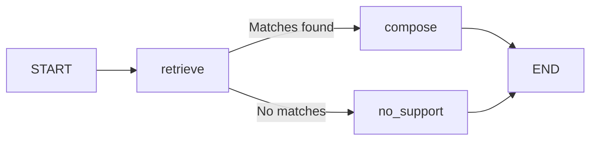

# Lesson 4 - LangGraph Workflows

> 60-90 minutes - Trace one state update at a time.

**Goal:** build an explicit retrieve-and-answer workflow with an unknown-answer branch.

**Prerequisites:** [retrieval and RAG](03-retrieval-and-rag.md), Python functions, and the [framework setup](README.md#setup).

**Focus:** state holds shared data; nodes perform steps; edges determine what runs next.

---

## The workflow



This application follows rules written by the programmer. It is a workflow; no language model chooses the next step.

A GNN's edges describe relationships between data objects. These LangGraph edges describe application control flow.

## Python example - Conditional routing

Save [lesson 3's complete example](03-retrieval-and-rag.md) as `retrieval.py`. Save this block beside it as `notes_workflow.py`.

```python
from typing import Literal
from typing_extensions import TypedDict
from langgraph.graph import END, START, StateGraph
from retrieval import retrieve

class NotesState(TypedDict, total=False):
    question: str
    matches: list[dict[str, str]]
    answer: str

def build_workflow(retriever=retrieve):
    def retrieve_node(state):
        return {"matches": retriever(state["question"])}

    def choose_branch(state) -> Literal["compose", "no_support"]:
        return "compose" if state["matches"] else "no_support"

    def compose_node(state):
        passages = [
            f"[{match['id']}] {match['text']}"
            for match in state["matches"]
        ]
        return {"answer": "\n".join(passages)}

    def no_support_node(state):
        return {"answer": "I could not find supporting notes."}

    graph = StateGraph(NotesState)
    graph.add_node("retrieve", retrieve_node)
    graph.add_node("compose", compose_node)
    graph.add_node("no_support", no_support_node)
    graph.add_edge(START, "retrieve")
    graph.add_conditional_edges(
        "retrieve", choose_branch,
        {"compose": "compose", "no_support": "no_support"},
    )
    graph.add_edge("compose", END)
    graph.add_edge("no_support", END)
    return graph.compile()

if __name__ == "__main__":
    app = build_workflow()
    for question in ["Why does BFS use a queue?", "Who won the football match?"]:
        result = app.invoke(
            {"question": question}, config={"recursion_limit": 8}
        )
        print(result["answer"])
```

**Expected:** the BFS question prints the graph passage with its source ID. The football question prints `I could not find supporting notes.`

The answer is an extractive quote, not generated reasoning. A retrieved candidate can still be irrelevant; inspect the evidence.

## What changes in state?

The initial input contains a question. The retrieval node returns a dictionary updating `matches`. The next node adds `answer`.

Nodes can return only the keys they update. With the default behavior used here, a new value replaces the previous value for that field. Appending to accumulated lists requires an appropriate reducer, which this example does not need.

`TypedDict` documents the expected structure for developers and tooling. It is not a substitute for validating user input at the application's boundary.

## Stopping and memory

Every branch reaches END. A recursion limit bounds graph steps if a future edit accidentally introduces a loop; it is not a token or monetary budget.

This example does not configure a checkpointer or durable conversation memory. Each invocation starts with the state you supply. Persistence is a later extension after you understand the basic graph.

## Exercises

1. Add a node that rejects an empty or whitespace-only question before retrieval.
2. Add a `source_count` state field and populate it after retrieval.
3. Pass a custom retriever returning an empty list. Confirm the unknown branch.
4. Add a deliberately repeating edge in a separate experiment and observe the recursion-limit error.

**Hints:** a node returns a state-update dictionary. A routing function returns a destination label.

## Checkpoint

- [ ] I can name each node's input and update.
- [ ] I can trace both branches to END.
- [ ] I can explain what state, routing, and persistence each mean.

Reference: [LangGraph Graph API](https://docs.langchain.com/oss/python/langgraph/graph-api).

Previous: [Retrieval and RAG](03-retrieval-and-rag.md). Next: [AI agents](05-ai-agents.md). [Track index](README.md) | [Progress](progress.md).
